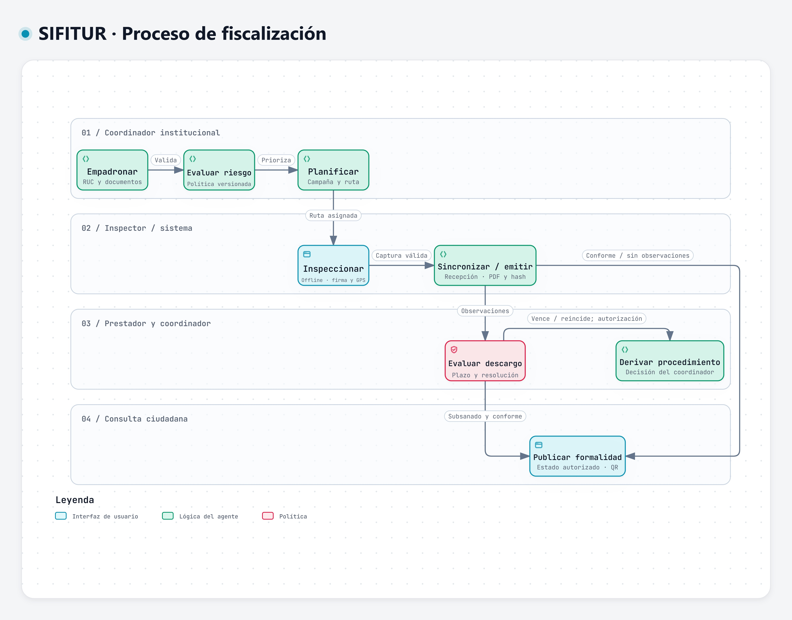

# Necesidad del negocio de SIFITUR Huamanga

## Problema y contexto

La fiscalización de hospedajes y servicios turísticos de Huamanga articula el padrón de prestadores, las visitas en campo, el control documental y el seguimiento de subsanaciones entre DIRCETUR Ayacucho y la Municipalidad Provincial de Huamanga. El registro manual en papel dificulta mantener expedientes y evidencias trazables durante todo el proceso.

SIFITUR Huamanga utiliza un aplicativo web para registrar inspecciones con conexión al servidor, gestionar los expedientes y permitir la consulta pública de formalidad mediante códigos QR.

## Objetivos del negocio

| ID | Objetivo | Requisitos relacionados |
|---|---|---|
| ON01 | Consolidar el padrón y controlar las vigencias documentales. | RF05, RF06 |
| ON02 | Priorizar establecimientos y coordinar operativos territoriales. | RF07, RF08, RF14 |
| ON03 | Registrar inspecciones, firmas digitalizadas y fotografías desde el aplicativo web. | RF09, RF10, RF11 |
| ON04 | Evaluar descargos y dar seguimiento a los plazos de subsanación. | RF12 |
| ON05 | Permitir la verificación ciudadana de servicios formales. | RF13 |
| ON06 | Controlar accesos y registrar acciones sensibles. | RF01, RF02, RF04, RF15 |

## Alcance del proceso

El proceso comprende empadronamiento, evaluación de riesgo, programación de operativos, inspección en campo, seguimiento de subsanaciones y publicación de formalidad. Los expedientes con observaciones mantienen su seguimiento hasta la subsanación o derivación al procedimiento sancionador.

## Usuarios y demanda

| Perfil | Usuarios registrados | Concurrencia promedio | Pico previsto | Canal |
|---|---|---|---|---|
| Inspector de campo | 35 | 15 | 35 concurrentes | Consola institucional React |
| Coordinador de fiscalización | 12 | 6 | 12 concurrentes | Consola administrativa React |
| Administrador TI | 4 | 2 | 4 concurrentes | Consola administrativa React |
| Prestador turístico | 600 establecimientos | 25 accesos diarios | 120 accesos diarios | Portal del administrado React |
| Turista / ciudadano | Público abierto | 400 accesos diarios | 8,000 accesos diarios; 900 solicitudes/minuto | Portal Next.js y visor QR |

La estimación considera 30,000 visitantes únicos acumulados en 4 a 6 días durante festividades y un patrón de 95 % lecturas y 5 % escrituras. La capacidad objetivo es 1,200 solicitudes por minuto. Los visitantes acumulados y los accesos diarios no representan usuarios concurrentes.

## Límites del alcance

El sistema gestiona información y trazabilidad de fiscalización; la resolución de sanciones corresponde al coordinador competente. El expediente registra la derivación y su resultado. La clasificación de riesgo consume antecedentes y denuncias ya registrados; la propuesta no desarrolla un procedimiento independiente de recepción ciudadana de denuncias.

La firma manuscrita capturada y el hash son mecanismos del expediente digital; el diseño no presupone un servicio de firma digital certificada. El acceso a sistemas de terceros y los parámetros institucionales de plazos, riesgo y retención se documentan como condiciones de implementación.

## Herramientas y fuentes de diagramas

Estos diagramas se elaboran con **Archify**, conforme al contenido de este documento. Cada imagen JPG se guarda en `img/` y se incrusta en su sección correspondiente. El JSON es la fuente editable; JPG, PNG y SVG son exportaciones generadas desde su visor nativo.

| Diagrama | Fuente | Visor |
|---|---|---|
| Proceso de fiscalización | [JSON Archify](../../.archify/sifitur-20261106-082100/proceso-fiscalizacion/candidate.json) | [HTML interactivo](../../.archify/sifitur-20261106-082100/proceso-fiscalizacion/proceso-fiscalizacion.html) |

[Catálogo y reproducción de diagramas](../../diagrams/README.md).
