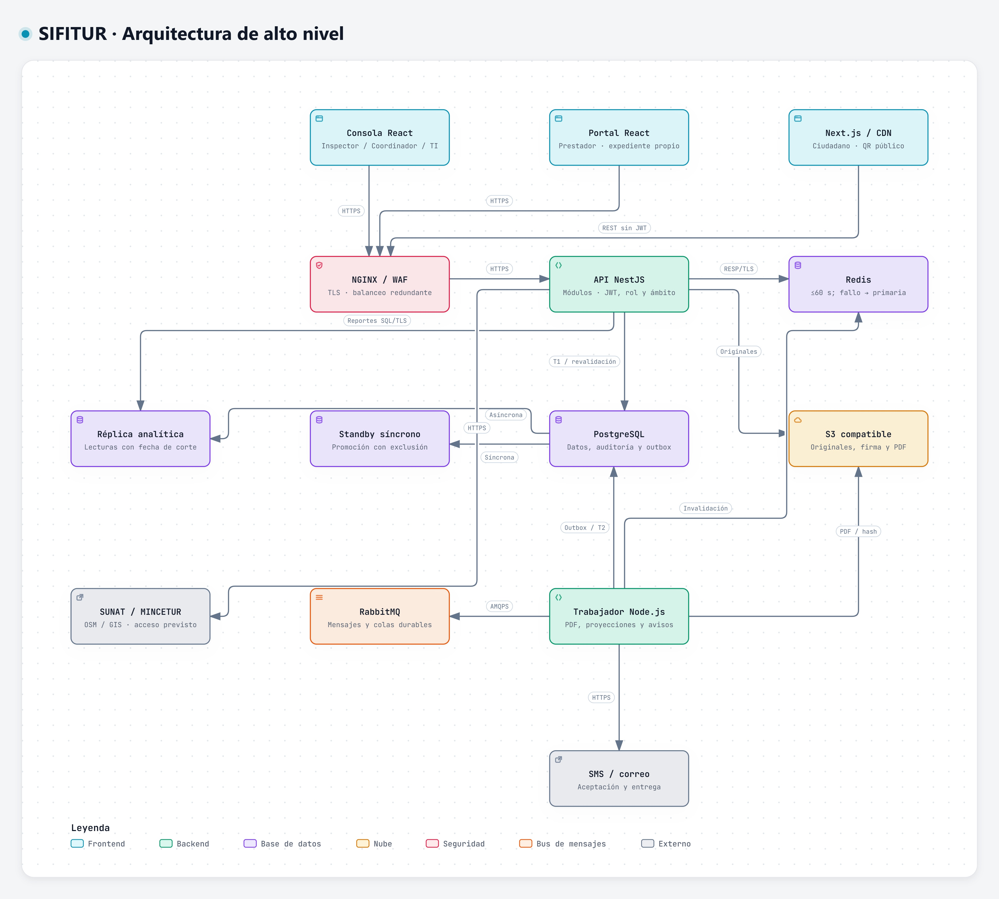

# Arquitectura inicial de SIFITUR Huamanga

## Diagrama de arquitectura

Exportación SVG: [arquitectura-alto-nivel.svg](../../img/fuentes-svg/arquitectura-alto-nivel.svg).

## Descripción

La arquitectura es cliente-servidor web. La consola institucional permite registrar inspecciones y coordinar operativos; el portal del administrado recibe descargos; el portal ciudadano verifica formalidad y códigos QR.

| Componente | Responsabilidad | Riesgo mitigado |
|---|---|---|
| CDN | Distribuir recursos estáticos del portal ciudadano. | Latencia y carga repetitiva. |
| Gateway y balanceador NGINX/WAF | Terminar TLS, filtrar y repartir peticiones entre instancias. | Saturación de una instancia y accesos perimetrales indebidos. |
| Backend NestJS sin estado | Ejecutar módulos institucionales en instancias equivalentes. | Dependencia de una máquina de cómputo. |
| PostgreSQL primaria | Confirmar escrituras, auditoría y outbox. | Inconsistencias transaccionales del expediente. |
| Réplica de lectura | Atender reportes y consultas que admiten desfase. | Saturación por lecturas analíticas. |
| Redis | Mantener la proyección pública del padrón y QR. | Consultas repetitivas a la base institucional. |
| S3 compatible | Custodiar originales fotográficos y actas PDF. | Pérdida de archivos al sustituir servidores. |
| RabbitMQ y trabajador | Generar documentos y despachar notificaciones mediante tareas recuperables. | Bloqueo de solicitudes por procesamiento pesado. |

La réplica no sustituye copias de seguridad. La conmutación de la primaria, retención de objetos y redundancia de gateway, caché y cola se configuran como parte del despliegue.

## Rutas de datos y continuidad

| Flujo | Recorrido | Garantía / degradación |
|---|---|---|
| Consulta pública | Portal → API → Redis; fallo o vencimiento → proyección validada en primaria. | Solo campos públicos; fecha y versión; antigüedad máxima de diseño de 60 s. |
| Inspección | Consola web React → carga autenticada → S3 → registro API → transacción primaria. | No se acusa recepción sin verificar objetos, auditoría y outbox; reintento por operación única. |
| Emisión | Publicador outbox del trabajador → RabbitMQ → consumidor de actas → S3 y primaria. | Mensaje con referencia al objeto; no transportar fotografías completas en el broker. |
| Notificación | Acta emitida → outbox → consumidor de notificación → pasarela. | Fallo de envío no revierte emisión; resultado y reintentos persistidos. |
| Indicadores | Consola → API privada → réplica / proyecciones analíticas. | Muestra fecha de corte; no decide sanciones con datos retrasados. |

El despliegue incorpora standby síncrono para continuidad de la primaria y réplica asíncrona para lecturas. La decisión se resume en ADR-008 del [catálogo de decisiones arquitectónicas](../01-analisis-de-sistema/07-decisiones-arquitectonicas.md). La consola web informa si el servidor no puede confirmar de forma durable; únicamente los borradores ya guardados en PostgreSQL pueden recuperarse.

## Herramientas y fuentes de diagramas

Estos diagramas se elaboran con **Archify**, conforme al contenido de este documento. Cada imagen JPG se guarda en `img/` y se incrusta en su sección correspondiente. El JSON es la fuente editable; JPG, PNG y SVG son exportaciones generadas desde su visor nativo.

| Diagrama | Fuente | Visor |
|---|---|---|
| Arquitectura de alto nivel | [JSON Archify](../../.archify/sifitur-20261106-082100/arquitectura-alto-nivel/candidate.json) | [HTML interactivo](../../.archify/sifitur-20261106-082100/arquitectura-alto-nivel/arquitectura-alto-nivel.html) |

[Catálogo y reproducción de diagramas](../../diagrams/README.md).
