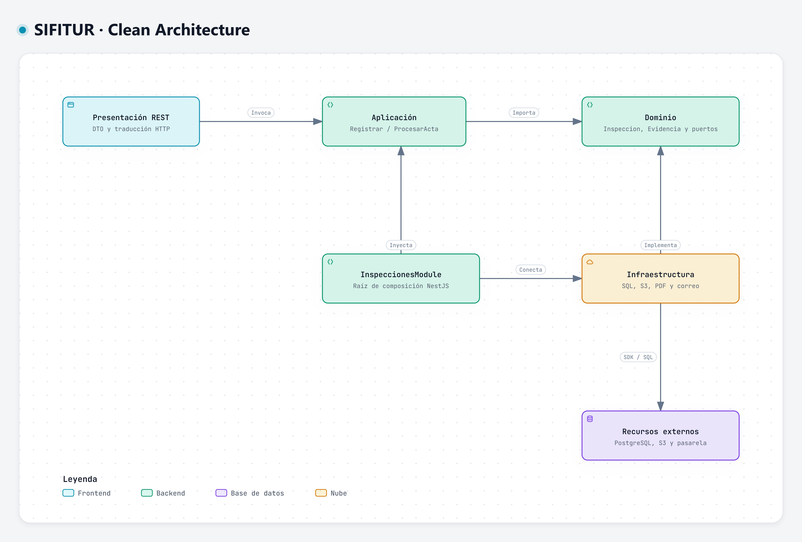

# Enfoque arquitectónico

## Clean Architecture de SIFITUR Huamanga

| Elemento | Descripción aplicada al proyecto |
|---|---|
| Enfoque | Clean Architecture dentro de cada módulo del backend. |
| Objetivo | Separar las reglas de fiscalización de frameworks, persistencia y servicios externos. |
| Problema resuelto | Evitar que las reglas de actas, vigencias, riesgo y subsanaciones dependan de NestJS, PostgreSQL, S3 o una pasarela de notificaciones. |
| Capas | Presentación, Aplicación, Dominio e Infraestructura. |
| Beneficio | Pruebas del núcleo sin framework; adaptadores intercambiables y responsabilidades explícitas. |

Exportación SVG: [arquitectura-limpia-sifitur.svg](../../img/fuentes-svg/arquitectura-limpia-sifitur.svg).

## Alcance y lectura del diagrama

La vista desarrolla **Clean Architecture dentro del módulo Inspecciones**, que es el módulo de referencia de la documentación. Detalla entradas, casos de uso, entidades, contratos y adaptadores; muestra además la raíz de composición y las dependencias técnicas. El resto de los módulos conserva su API pública y la propiedad de sus datos.

La aplicación institucional utiliza Node.js/NestJS y TypeScript. La entrada HTTP se ejecuta en la API; la recepción de eventos, la emisión del PDF y el consumidor de avisos se ejecutan en el trabajador. Ambos procesos reutilizan el diseño del módulo, sus reglas y sus contratos. El diagrama reúne estas responsabilidades de diseño; sus marcos de capas no representan un único proceso de ejecución.

La consola institucional React permite al inspector registrar fichas y adjuntar evidencias mediante el navegador. La comunicación HTTPS con `InspectionController` pasa por el gateway y los controles de acceso del backend. El perímetro completo, balanceador y almacenes se desarrollan en la [arquitectura inicial](arquitectura-inicial.md) y en el [nivel C4 de contenedores](../04-modelo-c4/Nivel2-DiagramadeContenedores.md).

| Rótulo de la relación | Interpretación |
|---|---|
| Invoca / solicita envío | Llamada en tiempo de ejecución desde una entrada al caso de uso o al contrato requerido. |
| Crea / valida | El caso de uso utiliza las entidades y sus invariantes para construir una inspección válida. |
| Usa puerto / verifica / genera / confirma T2 | El caso de uso solicita una operación a una interfaz interna; su código no conoce el adaptador concreto. |
| Realiza, línea discontinua | Un adaptador implementa un contrato del dominio. La dependencia de código apunta desde infraestructura hacia el contrato del núcleo. |
| Inyecta / registra | La composición selecciona implementaciones y entrega las dependencias a los casos de uso. |
| SQL/TLS, HTTPS/S3, biblioteca y HTTPS | Acceso técnico del adaptador a su recurso o proveedor; esa dependencia permanece fuera del núcleo. |

La llamada en ejecución y la dependencia de código son conceptos distintos: `RegistrarInspeccionCasoUso` invoca un objeto que implementa `AlmacenEvidencias`, mientras que `AlmacenEvidenciasS3` depende del contrato interno que realiza. El caso de uso no importa el SDK de S3.

## Capas y dependencias

| Capa | Contenido | Dependencias |
|---|---|---|
| Dominio | Inspeccion, Evidencia, Acta, reglas de vigencia y contratos. | Dominio y biblioteca estándar. |
| Aplicación | RegistrarInspeccionCasoUso, ProcesarActaCasoUso y coordinación de puertos. | Dominio. |
| Presentación | Controladores REST, DTO y traducción de errores HTTP. | Aplicación y dominio para tipos. |
| Infraestructura | Repositorios, objetos, generación de PDF y clientes institucionales. | Contratos del dominio y bibliotecas técnicas. |
| Composición | Módulos NestJS que seleccionan implementaciones. | Todas las capas para conectarlas. |

El dominio y los casos de uso no importan NestJS, ORM ni SDK de proveedores. Cada módulo expone una API pública; los demás módulos no acceden a sus repositorios internos. La presentación web consulta y guarda borradores en PostgreSQL mediante REST; el backend revalida las reglas y permisos antes de confirmar los cambios.

## Presentación y entradas

| Elemento | Ubicación prevista | Responsabilidad y límite |
|---|---|---|
| `InspectionController` | `presentacion/inspection.controller.ts`, en la API. | Traduce DTO y actor validado, invoca el caso de uso y convierte resultados o errores a HTTP. No ejecuta SQL ni genera PDF. |
| Entrada del trabajador | Consumidor de la tarea de emisión. | Recibe el evento durable y conecta su procesamiento con `ProcesarActaCasoUso`. El resultado se persiste antes del acuse al broker. |
| Consumidor de avisos | Trabajador, separado del consumidor de emisión. | Deduplica evento y destinatario; solicita el envío mediante `Notificador` y registra aceptación o entrega verificable. |
| Cliente React | Consola institucional web. | Consulta rutas y guarda borradores en el servidor; registra inspecciones con operación estable, sesión y permisos vigentes. La autorización institucional se decide en el servidor. |

## Aplicación: casos de uso

| Caso de uso | Entrada y colaboradores | Resultado |
|---|---|---|
| `RegistrarInspeccionCasoUso` | Comando y actor autenticado; validación de asignación y versión con Operativos; entidades `Inspeccion` y `Evidencia`; puertos `RepositorioInspecciones` y `AlmacenEvidencias`. | Verifica autorización, idempotencia e integridad y solicita T1. Devuelve recepción durable o el registro de una operación ya procesada; no espera al PDF ni al correo. |
| `ProcesarActaCasoUso` | Evento estable de una inspección recibida; puertos `RepositorioInspecciones`, `AlmacenEvidencias` y `GeneradorActas`. | Evita regenerar un acta emitida, genera el PDF, conserva objeto y hash y solicita T2 con la tarea posterior de notificación. |

La coordinación del caso de uso pertenece a aplicación. La pertenencia del expediente, la asignación vigente y las invariantes se comprueban mediante sus responsables. Aplicación no instancia conexiones SQL, clientes HTTP ni SDK de proveedores.

## Dominio: entidades, valores y reglas

| Elemento | Datos y comportamiento documentados |
|---|---|
| `Inspeccion` | Identifica operación, inspector, prestador, ficha, versión de ruta, evidencias y firma; distingue captura y recepción. `crear()` centraliza la construcción válida y `huella()` identifica el contenido estable. |
| `Evidencia` | Referencia al archivo original adjunto, nombre, tipo MIME, tamaño, fecha de recepción y hash SHA-256. El backend valida formato, tamaño e integridad antes de vincularlo. |
| `FirmaDigitalizada` | Referencia y hash de la firma manuscrita, vinculada a la inspección. No representa por sí misma una firma digital certificada. |
| `Acta` | Referencia al PDF, hash, fecha y estado de emisión. Su anulación requiere decisión autorizada y conserva el original y la trazabilidad. |
| Invariantes de construcción | RN-01: identidad de captura; RN-02: al menos una evidencia fotográfica válida; RN-03: firma vinculada. Se validan sin framework ni servicios externos. |

RN-04 a RN-07 también forman parte del comportamiento del módulo, pero requieren coordinación con aplicación y sus puertos: idempotencia, verificación real de objetos, emisión durable y conservación del acta aunque falle el aviso. No se atribuye al objeto de dominio la responsabilidad de consultar S3, confirmar una transacción o enviar correo.

## Contratos del núcleo y adaptadores

| Puerto interno | Operaciones de diseño | Adaptador y recurso técnico |
|---|---|---|
| `RepositorioInspecciones` | `buscarOperacion(clave)`, `registrarAtomico(inspeccion, huella)` y `confirmarActa(id, acta)`. | `RepositorioInspeccionesPostgres` en `infraestructura/repositorio-postgres.ts`: PostgreSQL, restricción única y transacciones T1/T2. |
| `AlmacenEvidencias` | `verificar(objetoId, hash)` y `guardarActa(id, bytes)`. | `AlmacenEvidenciasS3` en `infraestructura/almacen-s3.ts`: originales, firma, PDF, referencias estables y verificación del hash. |
| `GeneradorActas` | `generar(inspeccion): Promise<Uint8Array>`. | `GeneradorActasPdf` en `infraestructura/generador-actas-pdf.ts`: transforma la inspección en bytes usando una biblioteca PDF. |
| `Notificador` | `enviar(tarea): Promise<ResultadoEnvio>`. | `NotificadorInstitucional` en `infraestructura/notificador-institucional.ts`: pasarela SMS/correo y resultado verificable del envío. |

Las firmas resumen los contratos previstos del [diseño interno](../03-diseño-de-software/diseño-interno/diseño-interno-de-modulos.md). `Registro`, `Objeto`, `Acta`, `Notificacion` y los errores tipados permiten comunicar resultados sin exponer detalles del proveedor al caso de uso.

Los clientes de SUNAT, MINCETUR y GIS siguen la misma regla de puertos y adaptadores en los módulos responsables del padrón, operativos e indicadores. La [vista de componentes](../04-modelo-c4/Nivel3-Diagrama-de-Componentes.md) amplía esas integraciones; no se incorporan al agregado Inspecciones como responsabilidades propias.

## Raíz de composición

`inspecciones.module.ts`, representado por `InspeccionesModule`, registra los adaptadores concretos y conecta cada implementación con el contrato requerido. Es el punto del módulo que conoce simultáneamente las clases de infraestructura y los casos de uso.

La entrada HTTP conecta `InspectionController` con `RegistrarInspeccionCasoUso`. La entrada del trabajador conecta el consumidor de emisión con `ProcesarActaCasoUso`; el consumidor de avisos recibe su notificador. `index.ts` expone la API pública del módulo sin abrir sus repositorios privados a otros módulos.

Cambiar PostgreSQL, el proveedor de objetos, la biblioteca PDF o la pasarela requiere modificar el adaptador afectado y su composición. Las reglas de fiscalización y los casos de uso conservan los contratos internos. Los dobles de prueba pueden sustituir implementaciones al validar el núcleo; la durabilidad del motor real se verifica por separado.

## Reglas de dependencia

1. Dominio utiliza sus entidades, valores, reglas y contratos, junto con la biblioteca estándar.
2. Aplicación depende del dominio y coordina sus puertos; no depende de adaptadores concretos.
3. Presentación depende de aplicación y utiliza tipos del dominio para transformar entradas y salidas.
4. Infraestructura depende de los contratos del dominio y encapsula bibliotecas técnicas y protocolos.
5. Composición registra implementaciones e inyecta las dependencias; no concentra las reglas del expediente.
6. Cada módulo mantiene sus tablas y repositorios; la colaboración se realiza mediante su API pública.

## Flujo de registro web

1. La consola web guarda la ficha como borrador en el servidor y adjunta firma digitalizada y evidencias con un identificador de operación estable.
2. Con sesión vigente, la consola web envía el registro y las referencias de los archivos que el servidor confirmó.
3. El caso de uso comprueba autorización, idempotencia e integridad de los objetos recibidos.
4. El repositorio confirma inspección, auditoría y tarea outbox en una transacción institucional.
5. El trabajador genera y conserva el PDF, confirma el acta y registra la tarea de notificación.
6. Un reintento idéntico devuelve el mismo registro; un contenido distinto para la misma operación genera conflicto.

### Confirmación, errores y recuperación

| Situación | Comportamiento del diseño |
|---|---|
| Inspección nueva válida | Verifica los objetos; T1 confirma inspección, auditoría y outbox en PostgreSQL; responde `201 RECIBIDA`, con PDF pendiente. |
| Reenvío idéntico | Devuelve el mismo identificador y estado vigente con `200`; no crea otra inspección ni repite T1. |
| Operación reutilizada con otro contenido o versión incompatible | Devuelve `409`; conserva el borrador y no sobrescribe la inspección confirmada. |
| Evidencia, formato o firma inválidos | Rechaza la confirmación; las alternativas de entrada se traducen a `422` según el contrato REST. |
| Credencial o permiso inválidos | Devuelve `401` o `403`; no modifica el expediente y requiere autenticar o corregir el permiso. Los borradores previamente guardados permanecen en PostgreSQL. |
| Fallo del PDF o almacenamiento | Reanuda la emisión pendiente con identificadores estables; no confirma EMITIDA sin PDF y hash persistidos. |
| Fallo del correo | Conserva EMITIDA y la tarea de aviso; aplica reintentos acotados y revisión operativa. ACEPTADA no equivale a ENTREGADA. |

T1 y T2 son transacciones locales de PostgreSQL. S3 y RabbitMQ se coordinan mediante outbox, estados, confirmaciones y consumidores idempotentes; no existe una transacción ACID única entre los tres recursos. El navegador muestra confirmación únicamente después del acuse durable; no se garantiza recuperar datos que nunca llegaron al servidor. Emitir el acta tampoco declara por sí solo la formalidad pública del establecimiento.

## Trazabilidad del enfoque

| Requisitos / atributo | Responsabilidad que desarrolla la arquitectura |
|---|---|
| RF09 | Registro web, borradores en PostgreSQL, operación estable e idempotencia. |
| RF04 | Auditoría confirmada junto con la mutación sensible. |
| RF10 y RF11 | Custodia de originales, hash, firma vinculada, generación de PDF y notificación recuperable. |
| AC09 y ADR-002 / ADR-004 | Independencia del núcleo, contratos de módulo y sustitución de adaptadores. |

La estructura corresponde a un diseño de implementación previsto. La validación ejecutable de estas garantías se realiza cuando existan los componentes desplegados; el presente documento y su figura permiten revisar responsabilidades y dependencias antes de implementarlos.

## Elección frente a arquitectura hexagonal

Ambos enfoques separan negocio e infraestructura mediante puertos y adaptadores. SIFITUR utiliza Clean Architecture porque la documentación distingue explícitamente entidades, coordinación de casos de uso, traducción REST e infraestructura. Los puertos permanecen en el núcleo del módulo; ningún caso de uso instancia SDK de S3, conexiones SQL o clientes HTTP.

Las dependencias de código y el flujo de ejecución son distintos: en ejecución el caso de uso llama a un puerto cuyo objeto concreto es un adaptador; en código, el adaptador depende del contrato interno. La raíz de composición es el único punto que conoce ambos.

## Herramientas y fuentes de diagramas

Estos diagramas se elaboran con **Archify**, conforme al contenido de este documento. Cada imagen JPG se guarda en `img/` y se incrusta en su sección correspondiente. El JSON es la fuente editable; JPG, PNG y SVG son exportaciones generadas desde su visor nativo.

| Diagrama | Fuente | Visor |
|---|---|---|
| Clean Architecture del módulo Inspecciones | [JSON Archify](../../.archify/sifitur-20261106-082100/arquitectura-limpia-sifitur/candidate.json) | [HTML interactivo](../../.archify/sifitur-20261106-082100/arquitectura-limpia-sifitur/arquitectura-limpia-sifitur.html) |

[Catálogo y reproducción de diagramas](../../diagrams/README.md).
