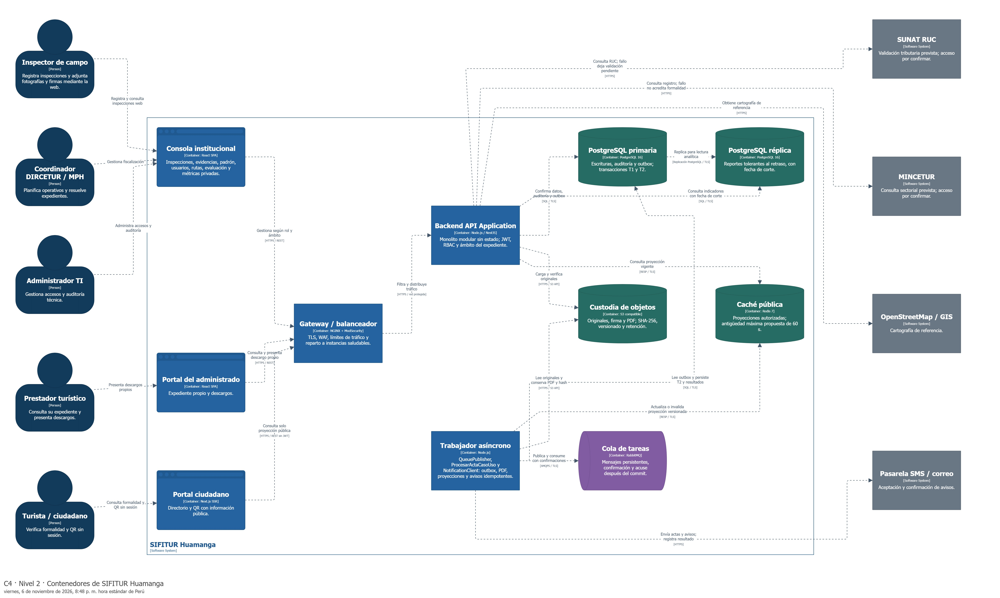

# Nivel 2 · Diagrama de contenedores

> **Proyecto:** SIFITUR Huamanga · **Modelo:** C4 · Nivel 2

## 1. Objetivo

Descomponer SIFITUR en aplicaciones ejecutables y almacenes de datos, indicando tecnologías, responsabilidades y protocolos. Audiencia: arquitectos, desarrolladores y operaciones.

## 2. Diagrama

Exportación SVG: [nivel2-contenedores.svg](../../img/fuentes-svg/nivel2-contenedores.svg).

### Lectura y organización de la vista

La figura se recorre de izquierda a derecha:

1. **Actores:** inspector, coordinador y administrador TI utilizan la consola institucional; prestador y ciudadano acceden a sus respectivos portales.
2. **Aplicaciones web y entrada:** los tres clientes se comunican con el gateway, que filtra y distribuye las solicitudes al backend.
3. **Procesamiento:** la API y el trabajador son contenedores separados; el trabajador conserva sus conexiones con los recursos que necesita.
4. **Persistencia y mensajería:** primaria y réplica se alinean en la fila superior; objetos y caché, en la intermedia; la cola se ubica junto al trabajador.
5. **Sistemas externos:** SUNAT, MINCETUR, GIS y la pasarela permanecen fuera del límite de SIFITUR, en el borde derecho.

Las posiciones y los recorridos se conservan en el [workspace JSON de Structurizr](../../diagrams/structurizr/modelo/workspace.json). El [script de distribución](../../scripts/organizar-nivel2-structurizr.mjs) aplica el mismo orden al regenerar. Se mantienen los once contenedores, cinco actores, cuatro sistemas externos y las 22 relaciones de esta vista. Las posiciones no implican nuevos procesos ni conexiones adicionales.

## 3. Contenedores

| Contenedor | Tecnología | Responsabilidad | Datos |
|---|---|---|---|
| Consola institucional | React SPA | Inspecciones, borradores, evidencias, padrón, usuarios, operativos, riesgo y evaluación. | Estado de interfaz. |
| Portal del administrado | React SPA | Expediente y descargos propios. | Estado de interfaz. |
| Portal ciudadano | Next.js SSR | Directorio y resolución QR pública. | Proyecciones autorizadas. |
| API Gateway / balanceador | NGINX + ModSecurity | TLS, filtrado y reparto de carga. | Configuración perimetral. |
| Backend API Application | Node.js/NestJS | Módulos, REST, JWT, RBAC y casos de uso. | Sin estado de sesión por instancia. |
| PostgreSQL primaria | PostgreSQL 16 | Transacciones, auditoría y outbox. | Información institucional. |
| PostgreSQL réplica | PostgreSQL 16 | Reportes y lectura tolerante al desfase. | Réplica de datos. |
| Caché | Redis 7 | Aceleración del directorio y QR. | Copias temporales de fichas públicas. |
| Objetos | S3 compatible | Custodia de originales y PDF. | Fotos, firmas y actas. |
| Cola | RabbitMQ | Entrega durable de trabajos. | Mensajes de tareas. |
| Trabajador | Node.js | Generación de actas, proyecciones y notificaciones. | Estado persistido en PostgreSQL. |

## 4. Relaciones

| Origen | Destino | Uso | Protocolo |
|---|---|---|---|
| Inspector | Consola institucional | Registro de inspecciones, carga de evidencias y consulta de rutas. | HTTPS |
| Coordinador / TI | Consola | Gestión institucional. | HTTPS |
| Prestador | Portal del administrado | Consulta y descargos. | HTTPS |
| Ciudadano | Portal ciudadano | Verificación de formalidad. | HTTPS |
| Apps y portales | Gateway → API | Operaciones privadas y consultas públicas. | HTTPS/REST; red interna protegida |
| API | Primaria / réplica | Escrituras / reportes. | SQL sobre TCP 5432 |
| API | Redis | Consulta de proyección pública. | RESP sobre TLS; puerto configurado |
| API / trabajador | S3 | Verificar evidencia / guardar PDF. | HTTPS/S3 API |
| Publicador outbox del trabajador | RabbitMQ | Publicar tareas confirmadas. | AMQPS / TLS 5671 |
| Trabajador | RabbitMQ | Suscribirse, consumir y confirmar tareas. | AMQPS / TLS 5671 |
| API | SUNAT / MINCETUR / GIS | Consultas institucionales y cartografía. | HTTPS |
| Trabajador | Pasarela SMS / correo | Remitir actas y avisos. | HTTPS |
| Primaria | Réplica | Replicación. | Protocolo PostgreSQL |

## 5. Decisiones arquitectónicas

| Decisión | Motivo |
|---|---|
| Backend modular replicable | Mantener límites de negocio y escalar por demanda sin dividir cada módulo en servicio. |
| Caché de proyección pública | Optimizar el patrón de 95 % lecturas; invalidar cuando cambia formalidad. |
| Objetos separados del cómputo | Preservar evidencias al sustituir una instancia de aplicación. |
| Outbox y trabajador | Evitar pérdida de tareas entre confirmación del expediente y publicación en la cola. |
| Registro por operación única | Evitar duplicados al repetir una solicitud web. |

## 6. Seguridad entre contenedores

Las rutas privadas verifican JWT, rol y pertenencia. El portal público no exige sesión. Bases, objetos y mensajería se acceden mediante credenciales del servidor; no se distribuyen a los clientes. Los datos en reposo se cifran y las conexiones de despliegue se protegen con TLS.

Anterior: [Contexto](Nivel1-DiagramadeContextodelSistema.md). Siguiente: [Componentes](Nivel3-Diagrama-de-Componentes.md).

## 7. Relaciones de procesamiento y almacenamiento

| Origen | Destino | Interacción |
|---|---|---|
| Consola institucional React | API REST y PostgreSQL | Guarda fichas y borradores en el servidor; adjunta archivos mediante la API autenticada. |
| Trabajador | PostgreSQL primaria | Lee outbox, confirma emisión y registra resultados de tareas; SQL sobre TLS. |
| Trabajador | Redis | Invalida o reemplaza proyecciones públicas versionadas; RESP sobre TLS. |
| Trabajador | S3 | Lee originales autorizados y guarda PDF y hash; HTTPS/S3 API. |
| Trabajador | RabbitMQ | Publica con confirmación y consume con acuse posterior a persistencia; AMQPS. |

El diagrama representa responsabilidades lógicas. El standby síncrono, réplicas físicas del broker, instancias API y dominios de fallo se detallan en el [HLD](../02-arquitectura-software/arquitectura-inicial.md); no constituyen nuevos módulos de negocio. La persistencia de borradores y expedientes es centralizada; el navegador requiere conexión con el servidor.

## Herramientas y fuentes de diagramas

Estas vistas se gestionan en **Structurizr** desde [workspace.dsl](../../diagrams/structurizr/workspace.dsl). [Abrir el visor C4](../../diagrams/structurizr/site/index.html).

Los niveles 1–3 son vistas nativas del modelo. Structurizr integra el nivel 4 como vistas de imagen vinculadas al componente Inspecciones; las clases y secuencias se mantienen en PlantUML y se renderizan localmente.

| Vista | Fuente | Visor |
|---|---|---|
| nivel2-contenedores | [Modelo DSL](../../diagrams/structurizr/workspace.dsl) | [Structurizr](../../diagrams/structurizr/site/index.html?diagram=nivel2-contenedores) |

[Catálogo y reproducción de diagramas](../../diagrams/README.md).
